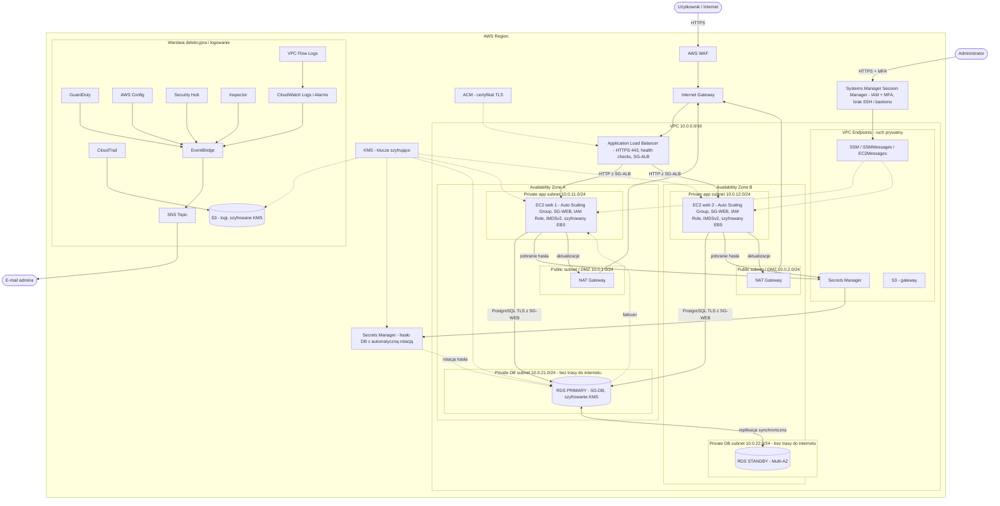

# AWS-infra

### Security Groups

**SG-ALB** (Application Load Balancer, public subnets)

| Kierunek | Protokół / port | Źródło / cel | Uwagi |
|---|---|---|---|
| Inbound | TCP 443 | 0.0.0.0/0 | HTTPS od użytkowników |
| Inbound | TCP 80 | 0.0.0.0/0 | HTTPS Redirect |
| Outbound | TCP 80 (port aplikacji) | SG-WEB | tylko do instancji web |

**SG-WEB** (EC2 w ASG, private app subnets)

| Kierunek | Protokół / port | Źródło / cel | Uwagi |
|---|---|---|---|
| Inbound | TCP 80 (lub 8080) | SG-ALB | wyłącznie ruch z load balancera |
| Outbound | TCP 5432 | SG-DB | dostęp do bazy |
| Outbound | TCP 443 | SG-VPCE | SSM, Secrets Manager przez VPC endpointy |
| Outbound | TCP 443 | 0.0.0.0/0 (przez NAT) | aktualizacje pakietów |

**SG-DB** (RDS primary + standby, private DB subnets)

| Kierunek | Protokół / port | Źródło / cel | Uwagi |
|---|---|---|---|
| Inbound | TCP 5432 | SG-WEB | jedyne źródło ruchu do bazy |
| Inbound | TCP 5432 | SG-ROTATION | rotacja haseł |
| Outbound | brak reguł | - | RDS nie inicjuje połączeń |

**SG-VPCE** (interface endpointy: ssm, ssmmessages, ec2messages, secretsmanager)

| Kierunek | Protokół / port | Źródło / cel | Uwagi |
|---|---|---|---|
| Inbound | TCP 443 | SG-WEB | tylko z instancji web |
| Inbound | TCP 443 | SG-ROTATION | rotacja haseł |
| Outbound | brak reguł | - | endpointy nie inicjują ruchu |

**SG-ROTATION** (Lambda rotująca hasło)

| Kierunek | Protokół / port | Źródło / cel |
|---|---|---|
| Inbound | brak | - |
| Outbound | TCP 5432 | SG-DB |
| Outbound | TCP 443 | SG-VPCE |

### Network ACL (druga warstwa, stateless)
**Public subnets (DMZ): 10.0.1.0/24, 10.0.2.0/24**

| Kierunek | Reguła | Protokół / port | Źródło / cel |
|---|---|---|---|
| Inbound | allow | TCP 443, 80 | 0.0.0.0/0 |
| Inbound | allow | TCP 1024-65535 | 0.0.0.0/0 (odpowiedzi z internetu dla NAT) |
| Outbound | allow | TCP 80 / 8080 | 10.0.11.0/24, 10.0.12.0/24 (ALB -> web) |
| Outbound | allow | TCP 443 | 0.0.0.0/0 (NAT -> internet) |
| Outbound | allow | TCP 1024-65535 | 0.0.0.0/0 (odpowiedzi do użytkowników) |
| Oba | deny | all | domyślnie |

**Private app subnets: 10.0.11.0/24, 10.0.12.0/24**

| Kierunek | Reguła | Protokół / port | Źródło / cel |
|---|---|---|---|
| Inbound | allow | TCP 80 / 8080 | 10.0.1.0/24, 10.0.2.0/24 (z ALB) |
| Inbound | allow | TCP 1024-65535 | 0.0.0.0/0 (odpowiedzi z NAT, endpointów, bazy) |
| Outbound | allow | TCP 3306 / 5432 | 10.0.21.0/24, 10.0.22.0/24 |
| Outbound | allow | TCP 443 | 0.0.0.0/0 (NAT i VPC endpointy) |
| Outbound | allow | TCP 1024-65535 | 10.0.1.0/24, 10.0.2.0/24 (odpowiedzi do ALB) |
| Oba | deny | all | domyślnie |

**Private DB subnets: 10.0.21.0/24, 10.0.22.0/24**

| Kierunek | Reguła | Protokół / port | Źródło / cel |
|---|---|---|---|
| Inbound | allow | TCP 3306 / 5432 | 10.0.11.0/24, 10.0.12.0/24 |
| Outbound | allow | TCP 1024-65535 | 10.0.11.0/24, 10.0.12.0/24 |
| Oba | deny | all | domyślnie |

### AWS WAF (Web ACL podpięty do ALB)

| Priorytet | Reguła | Akcja |
|---|---|---|
| 1 | AWSManagedRulesAmazonIpReputationList | Block |
| 2 | Rate-based rule: np. 2000 żądań / 5 min na IP | Block |
| 3 | AWSManagedRulesCommonRuleSet | Block |
| 4 | AWSManagedRulesKnownBadInputsRuleSet | Block |
| 5 | AWSManagedRulesSQLiRuleSet | Block |
| Domyślna | - | Allow |